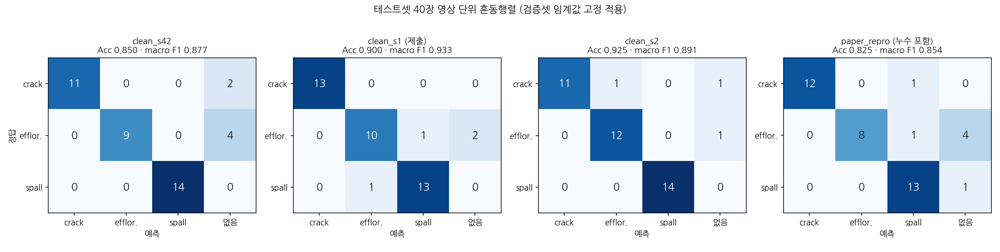

# 지하 콘크리트 결함 세그멘테이션 — AI 모델 재현 및 성능 비교

Kim, Kim, Kong, Lee & Choi, *Detection and Segmentation of Multiple Surface Defects in Underground Concrete Structures Using YOLOv8s-Seg*의 1인 재현 과제 (Step 3).
AI Hub 지하 콘크리트 구조물 영상에서 **균열(crack) · 백화(efflorescence) · 박리·박락(spall_detach)** 을 YOLOv8s-Seg로 분할하고, 영상마다 결함 유무를 판정(ON/OFF)한다.

## 결과 한눈에 보기

| 평가 (테스트셋 40장) | 제출 모델 clean_s1 | 시드 3개 평균 ± 표준편차 | 논문 |
|---|---:|---:|---:|
| mask mAP50 | **0.710** | 0.696 ± 0.035 | 0.443 |
| mask mAP50-95 | **0.321** | 0.327 ± 0.005 | 0.222 |
| ON/OFF macro F1 | **0.933** | 0.900 ± 0.029 | 0.896 |

- **임계값과 제출 모델은 검증셋에서만 정했다.** 클래스별 임계값(crack 0.1, efflorescence 0.06, spall_detach 0.01)과 대표 시드는 테스트를 돌리기 전에 [`results/improve/protocol.json`](results/improve/protocol.json)에 고정했다. 테스트 단계 코드는 이 파일을 읽기만 한다.
- **mask mAP는 시드 3개 모두 논문보다 0.2 이상 높다.** macro F1의 차이는 테스트 1장이 클래스 F1을 바꾸는 폭(약 0.03\~0.04) 안에 있어, 논문과 같은 수준으로 판단한다.
- **가장 약한 클래스는 백화다.** 오분류는 작거나 흐린 백화, 박락면 위의 백화, 분필 점검 표시에서 나왔다(3절).

---

## 1. 코드 설명

### 사용한 데이터 및 전처리 방법

| 항목 | 내용 |
|---|---|
| 데이터 | AI Hub 지하 콘크리트 구조물 결함 영상(논문 저자 정리본). train 4,036 / val 40 / test 40장, YOLO 세그멘테이션 라벨(폴리곤), 1920×1080. **재배포 금지라 저장소에 넣지 않는다** |
| 데이터 점검 | train은 원본 120프레임을 오프라인 증강한 것(97 %가 증강본). 영상마다 한 클래스만 라벨됨 (`src/week1_audit.py`, `results/week1/`) |
| 제외 1 | 읽을 수 없는 **0바이트 영상 63장** (`results/week1/unreadable_images.csv`) |
| 제외 2 | test 프레임 `URT017_2020_02_08_001_24512`와 **원본이 같은 train 영상 55장**. 원본 단위로 누수를 없앰 (`src/week2_prepare.py`, `src/common.py`의 `origin_id`) |
| 최종 분할 | train 3,918 / val 40 / test 40. 원본 프레임 겹침 0. 제공 분할은 바꾸지 않음 |
| 클래스 | 0 crack, 1 efflorescence, 2 spall_detach (`dataset/data.yaml`) |
| 직접 주석 | train 원본 15장, 54개를 CVAT로 직접 그려 제공 라벨과 비교(학습에는 미사용, `results/week2/annotation/`) |

### 사용한 AI 모델

| 모델 | 설명 |
|---|---|
| **clean_s42 / clean_s1 / clean_s2** | 누수를 제거한 train으로 학습한 YOLOv8s-Seg, 시드만 다름. **clean_s1이 제출 모델** |
| **paper_repro** | 논문 조건 그대로(0바이트만 제외, test와 같은 원본 55장 포함) 학습한 YOLOv8s-Seg. 비교용 |

공통 설정: `yolov8s-seg.pt`(COCO 사전학습), imgsz 960, 60 epoch(조기 종료 없음), batch 4, AdamW lr0 0.00015, mosaic 0, mixup 0, deterministic.
- **imgsz 960**: 균열 폭 중앙값이 원본 44.7 px라, 960에서는 22.4 px, 640에서는 14.9 px로 줄어든다(하위 10 %는 12.6 px).
- **Mosaic·MixUp 끔**: 모자이크는 가는 균열을 자르거나 작게 만들고, MixUp은 흰 석출물과 얼룩의 질감을 섞는다. train도 이미 오프라인 증강본이다.

### 학습 및 테스트 방법

1. **학습**: clean은 시드 42·1·2, paper_repro는 시드 42 하나로 60 epoch 학습. 각 모델은 검증셋 box+mask mAP50-95 합이 가장 높은 epoch를 쓴다(clean_s1은 epoch 39).
2. **ON/OFF 판정**: 영상에 그 클래스 정답이 하나라도 있으면 정답 ON, 그 클래스 예측 중 confidence ≥ 임계값이 하나라도 있으면 예측 ON. 예측은 `conf=0.001`로 모두 받은 뒤 임계값을 적용한다. 강의 코드의 기본값 0.25로 받으면 0.25보다 낮은 임계값이 의미가 없어진다.
3. **임계값 탐색(검증셋만)**: 0.001\~0.7의 12개 값에서 클래스별 F1이 가장 높은 값을 고르고, 동점이면 낮은 값을 골라 recall을 우선한다. 강의 범위(0.001\~0.3)에 0.4\~0.7을 더한 것은 앞선 논문 조건 실험의 검증 곡선이 0.3까지 평평했기 때문이다. 제출 모델(clean_s1)은 강의 범위로만 골라도 세 임계값이 같다. clean_s2의 spall_detach만 강의 범위에서는 0.01, 넓힌 범위에서는 0.5가 골라진다.
4. **제출 모델 선택(검증셋만)**: (검증 mask mAP50 + 검증 macro F1)/2가 가장 높은 시드 → **시드 1** (0.802 > 0.764, 0.744). 타일 추론도 후보였지만 검증 macro F1이 낮아(0.860 < 0.868) 쓰지 않았다.
5. **테스트**: 고정한 모델과 임계값을 테스트셋에 한 번 적용한다(`improve_eval.py --stage test`). 결과 파일이 있으면 다시 실행되지 않는다. 이후 보고용 재실행(클래스별 mAP50-95, 오류 그림)은 값을 바꾸지 않고 `results/improve/test_attempts.log`에 기록했다.

### 실행 방법

```bash
bash setup.sh && source .venv/bin/activate      # Python 3.10~3.11, requirements.lock.txt (torch 2.14.1, ultralytics 8.4.198)
# 데이터: AI Hub 정리본을 data/에 푼다

python src/week2_prepare.py                     # 데이터 점검·누수 제거 → dataset/
sh src/improve_train.sh                         # 시드 42·1·2 학습 (GPU, RTX 4090에서 실행)
python src/improve_eval.py --stage val          # 검증셋으로 임계값·대표 시드 고정 → results/improve/protocol.json
python src/improve_eval.py --stage test         # 고정값을 테스트셋에 1회 적용 → results/improve/test_results.json
python src/week3_eval.py                        # 고정값 재확인·검증 F1 곡선·테스트 ON/OFF 표 (저장된 점수 사용, GPU 불필요)
python src/week3_compare.py                     # 모델 비교·혼동행렬 (저장된 점수 사용, GPU 불필요)
```

제출 모델 가중치는 [`weights/best.pt`](weights/best.pt)다(sha256 `356a61cf…`, `protocol.json`에 기록된 값과 같음). 학습 없이 결과만 다시 계산하려면 이 파일을 `results/improve/train_s1/weights/`에 복사한 뒤 마지막 두 명령을 실행한다(`week3_eval.py`가 가중치 해시를 확인한다). `python main.py week3`은 이 둘에 보고서 PDF 생성까지 하며, PDF 생성에는 WSL에서 Windows Chrome을 쓴다.

### 코드 설명

| 파일 | 설명 |
|---|---|
| `main.py` | 단일 진입점. `python main.py week1 / week2 / week3` |
| `src/common.py` | 클래스 이름, 원본 ID(`origin_id`) 추출 |
| `src/week1_*.py` | 데이터 점검(0바이트·중복·밝기), 샘플·하드 네거티브 그림 |
| `src/week2_prepare.py` | 무결성 점검과 원본 단위 누수 제거로 `dataset/` 생성 |
| `src/week2_train.py` | YOLOv8s-Seg 학습(논문·강의 설정) |
| `src/week2_annotation.py` | 직접 주석 묶음 선택, CVAT 내보내기 점검·집계(클래스 오지정 수정 `--relabel`) |
| `src/week2_checks.py`, `src/week2_curve.py` | 포맷 확인, 학습 곡선 |
| `src/paper_prepare.py`, `src/paper_run.sh`, `src/eval_onoff.py` | 논문 조건 재현 실험(paper_repro) |
| `src/improve_train.sh` | 누수 제거 데이터로 시드 3개 학습 |
| `src/improve_eval.py` | 검증셋 임계값·시드 선택 → protocol 고정 → 테스트 적용 |
| `src/week3_eval.py` | 고정값 재확인, 검증 F1 곡선, 테스트 ON/OFF 표, FP·FN 사례 |
| `src/week3_compare.py` | 모델별 성능 비교와 영상 단위 혼동행렬 |
| `report/build_week*_report.py`, `src/week*_package.py` | 주차별 보고서 PDF와 제출 파일 |

---

## 2. 모델 성능 비교

테스트셋 40장. 임계값은 모델마다 각자의 검증셋에서 고른 값이다. Accuracy는 영상의 예측 클래스(임계값을 넘은 클래스 중 confidence가 가장 높은 것)가 정답 클래스와 같은 비율이다. Precision·Recall·F1은 클래스별 ON/OFF 값의 macro 평균이다 (`results/week3/model_comparison.csv`).

| Model | mask mAP50 | mask mAP50-95 | Accuracy | Precision | Recall | F1-score |
|---|---:|---:|---:|---:|---:|---:|
| clean_s42 | 0.656 | **0.331** | 0.850 | 0.931 | 0.846 | 0.877 |
| **clean_s1 (제출)** | 0.710 | 0.321 | 0.900 | **0.947** | **0.923** | **0.933** |
| clean_s2 | **0.723** | 0.329 | **0.925** | 0.865 | **0.923** | 0.891 |
| paper_repro (누수 포함) | 0.631 | 0.290 | 0.825 | 0.922 | 0.822 | 0.854 |
| 논문 | 0.443 | 0.222 | – | – | – | 0.896 |

클래스별 ON/OFF F1과 검증셋 임계값:

| Model | 임계값 (crack / efflor. / spall) | crack F1 | efflorescence F1 | spall_detach F1 |
|---|---|---:|---:|---:|
| clean_s42 | 0.2 / 0.3 / 0.01 | 0.880 | 0.818 | 0.933 |
| clean_s1 | 0.1 / 0.06 / 0.01 | **1.000** | 0.833 | 0.966 |
| clean_s2 | 0.06 / 0.001 / 0.5 | 0.846 | 0.828 | **1.000** |
| paper_repro | 0.06 / 0.1 / 0.02 | 0.960 | 0.762 | 0.839 |

### 성능 분석

- **ON/OFF F1이 가장 높은 모델은 clean_s1**이다(0.933). crack 13장을 모두 맞혔고, 세 클래스의 precision과 recall이 함께 높다.
- **clean_s2는 테스트 mAP50과 Accuracy가 조금 더 높다.** 하지만 제출 모델은 테스트 전에 검증셋 기준으로 정한 것이라 바꾸지 않았다. 테스트를 보고 모델을 바꾸면 테스트가 선택에 쓰여 성능이 과대평가된다. 시드 간 차이(mAP50 0.656\~0.723, F1 0.877\~0.933)가 크다는 점 자체가 결과다. 40장 테스트에서는 한두 장이 순위를 바꾼다.
- **임계값이 시드마다 크게 다르다**(예: spall_detach 0.01 vs 0.5). 검증셋이 40장이라 F1 곡선이 넓게 평평하고, 영상 한 장 차이로 정점이 옮겨 가기 때문이다. clean_s2의 spall_detach는 0.01에서 F1 0.788, 0.5에서 0.800으로, 영상 1장 차이로 0.5가 골라졌다. 시드 3개 평균으로는 공통 임계값 하나(0.906 ± 0.014)가 클래스별 임계값(0.900 ± 0.029)과 같은 수준이었다.
- **paper_repro가 가장 낮다.** 다만 시드 하나로만 학습한 결과이고, clean 시드 간 차이(F1 0.877\~0.933) 바로 아래에 있어 누수 포함 여부의 효과라고 말하기 어렵다. 원인은 확인하지 못했다. 누수를 남긴 이 모델도 mAP50 0.631로 논문(0.443)보다 높으므로, 논문과의 큰 mAP 차이는 누수 제거에서 온 것이 아니다.

---

## 3. Confusion Matrix 분석



행은 정답 클래스, 열은 예측 클래스다. '없음'은 어떤 클래스도 임계값을 넘지 못한 경우다. 테스트 영상마다 정답 클래스는 하나다.

### clean_s42
- **가장 잘 분류된 클래스**: spall_detach (14/14)
- **가장 많이 오분류된 클래스**: efflorescence (13장 중 4장 미검출)
- **주요 오분류 유형**: 결함을 못 찾는 미탐(FN). crack 2장, efflorescence 4장이 '없음'으로 판정됐다. 다른 클래스와 헷갈린 경우는 없다.
- **오분류가 발생한 이유**: 미탐 6장 중 임계값 때문에 놓친 것은 백화 1장(점수 0.224 < 임계값 0.3)뿐이다. 나머지 5장(crack 0.000·0.014, 백화 0.007·0.039·0.045)은 모델이 거의 반응하지 않아 임계값을 낮춰도 살리기 어려운 표현 부족이다. 이 시드는 crack 0.2, efflorescence 0.3으로 다른 시드보다 높은 임계값이 골라져 경계 사례에서 불리했다.

### clean_s1 (제출 모델)
- **가장 잘 분류된 클래스**: crack (13/13)
- **가장 많이 오분류된 클래스**: efflorescence (13장 중 10장 정답, 1장은 spall_detach, 2장은 '없음')
- **주요 오분류 유형**: 백화 미탐 2장, 백화↔박락 혼동 2장
- **오분류가 발생한 이유**:
  - 미탐 2장은 흙손 자국 면 위의 **작은 흰 덩어리**와 줄무늬 벽의 **흐릿한 백화**다. 백화 점수가 0.002 이하라 임계값을 바꿔서는 고칠 수 없다.
  - 백화→박락 1장은 **박락으로 거칠어진 면에 흰 석출물이 붙은 영상**이다. 제공 라벨은 영상당 한 클래스뿐이라 실제로 보이는 박락이 오답으로 셈해졌을 가능성이 있다.
  - 박락→백화 1장은 점검자가 **분필로 쓴 흰 글씨와 X 표시**를 백화(0.80)로 본 경우다. 이 영상은 누수 제거로 train에서 같은 원본 55장을 뺀 장면이다.

### clean_s2
- **가장 잘 분류된 클래스**: spall_detach (14/14)
- **가장 많이 오분류된 클래스**: crack (13장 중 11장 정답, 1장 efflorescence, 1장 '없음')
- **주요 오분류 유형**: 균열 미탐과 백화 오탐. 클래스별로 보면 박락·균열 영상 4장에서 백화가 함께 ON이 되었다(precision 0.865).
- **오분류가 발생한 이유**: 검증셋에서 백화 F1이 0.001부터 평평해 가장 낮은 임계값 0.001이 골라졌다. 그래서 0.002\~0.006 같은 아주 낮은 백화 점수도 ON이 된다. 균열→백화 1장은 균열 점수(0.025)가 임계값 0.06에 못 미치고, 백화 점수 0.0016이 0.001을 넘은 경우다.

### paper_repro
- **가장 잘 분류된 클래스**: spall_detach (13/14), crack (12/13)
- **가장 많이 오분류된 클래스**: efflorescence (13장 중 8장 정답, 4장 '없음', 1장 spall_detach)
- **주요 오분류 유형**: 백화 미탐
- **오분류가 발생한 이유**: 네 모델 모두 공통으로 백화가 가장 약하다. 경계가 흐리고 크기가 작으며, 흰 변색·분필과 구분이 어렵다. 학습 데이터에 이런 사례가 적은 것으로 보인다(수를 세어 확인하지는 않음).

### 모델 공통으로 본 오류 원인
| 원인 | 결과 | 대응 |
|---|---|---|
| 작고 대비가 낮은 백화, 퍼진 경계 | 백화 미탐 | 소형·저대비 백화 추가 주석 |
| 박락면 위 백화 (두 결함 공존, 라벨은 하나) | 백화↔박락 혼동 | 주석 기준: 두 클래스를 모두 그림 |
| 분필 점검 표시(흰 획) | 백화 오탐 | 분필 표시 하드 네거티브, 기준서 제외 대상으로 명시 |
| 가는 긁힘·흙손 자국 | crack 점수가 임계값 근처(0.097 vs 0.1) | 긁힘 하드 네거티브 |

---

## 4. 최종 결과

- **가장 성능이 좋은 모델**: **clean_s1** (ON/OFF macro F1 0.933, mask mAP50 0.710). 테스트 전에 검증셋으로 고른 제출 모델이다. mAP50과 Accuracy만 보면 clean_s2(0.723, 0.925)가 조금 높다.
- **가장 성능이 낮은 모델**: **paper_repro** (macro F1 0.854, mask mAP50 0.631)
- **주요 오분류 클래스**: **efflorescence**. 네 모델 모두에서 가장 많이 놓쳤고, 박락·분필 표시와도 헷갈렸다.
- **전체적인 실험 결과 및 느낀 점**:
  - 테스트 mask mAP50은 시드 3개 모두 논문(0.443)보다 높은 0.656\~0.723이었다. ON/OFF macro F1(0.877\~0.933)은 논문(0.896)과 같은 수준이었다.
  - 같은 설정에서도 시드에 따라 F1이 0.06 차이 났다. 그래서 40장 테스트에서는 모델 하나의 숫자보다, **임계값과 모델을 검증셋에서 정하고 테스트에는 고정하는 절차**가 결과를 믿을 수 있게 만든다는 것을 확인했다. 테스트를 보고 시드 2로 바꿨다면 숫자는 좋아 보였겠지만 그 숫자는 과대평가다.
  - 데이터를 직접 열어 본 것이 중요했다. 0바이트 영상 63장, test와 같은 원본의 train 영상 55장, 영상당 한 클래스만 있는 라벨은 데이터를 열어 보고서야 알 수 있었다. 이 세 가지가 학습 데이터와 오류 해석을 바꿨다.
  - 경계 정확도(mAP50-95 0.32)는 여전히 낮다. 특히 crack은 폭이 수십 픽셀이라 1\~2 px만 어긋나도 IoU가 떨어진다. 반면 "어느 영상에 결함이 있는지" 고르는 선별은 macro F1 0.93으로 쓸 만했다. 현장 선별 도구로는 ON/OFF 평가가 더 맞는 기준이다.
  - 한계: 테스트 40장(1장이 F1을 약 0.03 바꿈), 테스트 25장이 train과 같은 촬영본(train에 없는 촬영본 15장만으로는 mAP50 0.660), 촬영 축척이 없어 mm·m² 단위 정량화 불가, 모델 구조는 YOLOv8s-Seg 하나.

### 결과 파일

| 파일 | 내용 |
|---|---|
| `results/improve/protocol.json` | 검증셋으로 고정한 임계값·시드·규칙 (테스트 전 기록) |
| `results/improve/test_results.json` | 시드별 테스트 결과(mAP, ON/OFF) |
| `results/week3/val_threshold_f1.png`, `.csv` | 제출 모델 검증셋 클래스별 F1 곡선 |
| `results/week3/test_onoff.csv` | 제출 모델 테스트 TP·FP·FN·TN·Precision·Recall·F1 |
| `results/week3/model_comparison.csv`, `confusion_matrices.png` | 모델 비교와 혼동행렬 |
| `results/week3/error_cases.csv` | FP·FN 영상 목록과 점수 |
| `results/week2/curve.png`, `results/improve/curve_s1.png` | 학습 곡선 |
